<!-- Preview cards are SVGs drawn by scripts/render_previews.py. Keep each row of cards on one line with no spaces between the links. -->

 
 
 
 

## Case studies

| Case study | What it shows |
|---|---|
| [From one client meeting to a 3,104-product price catalogue](case-studies/price-catalogue-electronics-retail.md) | Requirements traced to evidence, a 22-case acceptance test, 237 automated tests and four releases in five days |
| [A laundry service, from idea to both app stores](case-studies/advance-washing-zero-to-one.md) | 0-to-1 delivery with a CEO, App Store and Google Play review, and a WhatsApp channel that brings in 80% of customers |
| [Running a multi-tenant WhatsApp automation platform](case-studies/enorbit-whatsapp-platform.md) | Client onboarding, Meta compliance, and two incidents solved with data: 8 safeguards and a campaign post-mortem |
| [About 20 client websites in one year, for a digital agency](case-studies/agency-portfolio-20-websites.md) | Running many small projects in parallel, with scope, client inputs, approvals and payments in one tracker |
| [Leading a team of 4–5 to ship a virtual jewellery try-on](case-studies/alankara-ai-virtual-try-on.md) | Team leadership and a computer-vision product released on web, tablet and an in-store kiosk |
| [One client, two platforms](case-studies/one-client-two-platforms.md) | A training platform, then laundry operations on WhatsApp, for the same business owner |
| [From a hand-drawn sketch to a live WhatsApp flow](case-studies/jewellery-retailer-sketch-to-whatsapp-flow.md) | Turning an informal brief into a requirement, with written assumptions and a rollback path |
| [A CRM 15 people used every day, and why it was switched off](case-studies/support-crm-retired.md) | What adoption doesn't protect you from, and two questions to ask before designing anything |

## Templates

| Template | Use it when |
|---|---|
| [Requirements audit](templates/requirements-audit.md) | After a client meeting, to trace every request to what the system does and the evidence that it works |
| [UAT checklist](templates/uat-checklist.md) | Before sign-off, to run acceptance tests on the live system with the client |
| [Release checklist](templates/release-checklist.md) | Before every production, App Store or Google Play release |
| [Weekly status report](templates/weekly-status-report.md) | Every week, to keep founders and stakeholders informed about scope, risks and dates |

## How I work

1. Record the meeting and write the requirements down in the client's words.
2. Trace each requirement to what will be built and how it will be tested.
3. Release in small steps. Database changes go in before the code that needs them.
4. Test against the requirement table, not against memory.
5. After each release, check that the live data is unchanged.

There is no client code in this repository. Client names are left out unless the client is public about the work.

## Contact

- LinkedIn: [linkedin.com/in/krishnachaitanyadoppa](https://www.linkedin.com/in/krishnachaitanyadoppa/)
- GitHub: [github.com/Krishnachaitanya-dev](https://github.com/Krishnachaitanya-dev)

Preview cards are drawn in code by `scripts/render_previews.py`. Fonts: Instrument Serif, Geist and Geist Mono, under the SIL Open Font License 1.1.
